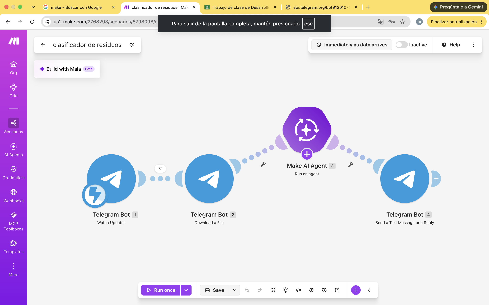

# Nombre del proyecto
automatización con chatbot de residuos

## Objetivos de aprendizaje
El objetivo es identificar el impacto de los residuos que se generan en la vida diaria, 

## Material utilizado

- make.com
- telefono celular
- fotografias
- laptop
- modulo de IA
 

## codigo
[main.txt](codigo/main.txt)

## Video del funcionamiento

[readme](video/readme.txt)

[Ver video en YouTube](https://youtube.com/shorts/iNmEj_lk2ro)

## imagenes

## Reporte
Incluye:
[pracre.pdf](resultados/pracre.pdf)

## Conclusiones
Un clasificador con IA se armó sin programar y responde en pocos segundos, pero sus respuestas dependen de la calidad de la foto, se confunden con materiales mezclados y no consideran la infraestructura local. Por eso hay que verificarlas con fuentes confiables.

