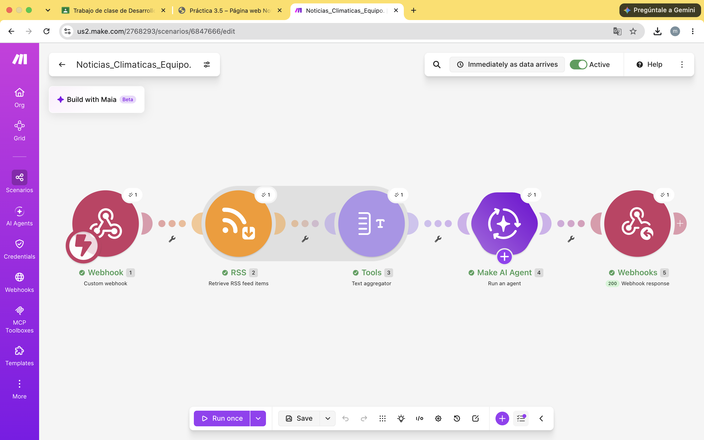

# Nombre del proyecto
automatización con make

## Objetivos de aprendizaje
Construir un flujo de automatización sin programación tradicional (No-Code) que extraiga noticias ambientales en tiempo real mediante RSS, genere resúmenes automáticos y sintéticos orientados a la conciencia comunitaria usando Inteligencia Artificial, y los presente en un sitio web público hospedado en GitHub Pages.
## Material utilizado

- make.com
- telefono celular
- laptop
- modulo de IA
 

## codigo
[main.txt](codigo/main.txt)

## Video del funcionamiento

[readme](video/readme.txt)

[Ver video en YouTube](https://youtu.be/Ir9_YWsbrC8)

## imagenes

## Conclusiones
Automatizar este bot permitió comprender que una automatización no es solo conectar módulos, sino asegurarse de que los datos correctos lleguen, en el formato correcto, al lugar correcto. También quedó claro que el trabajo con Inteligencia Artificial requiere instrucciones precisas y una verificación constante mediante pruebas reales, ya que pequeños errores de configuración pueden hacer que todo el sistema deje de cumplir su propósito, aunque a simple vista parezca estar funcionando.

##resultados#

[ReportePráctica3.pdf](resultados/ReportePráctica3.pdf)

