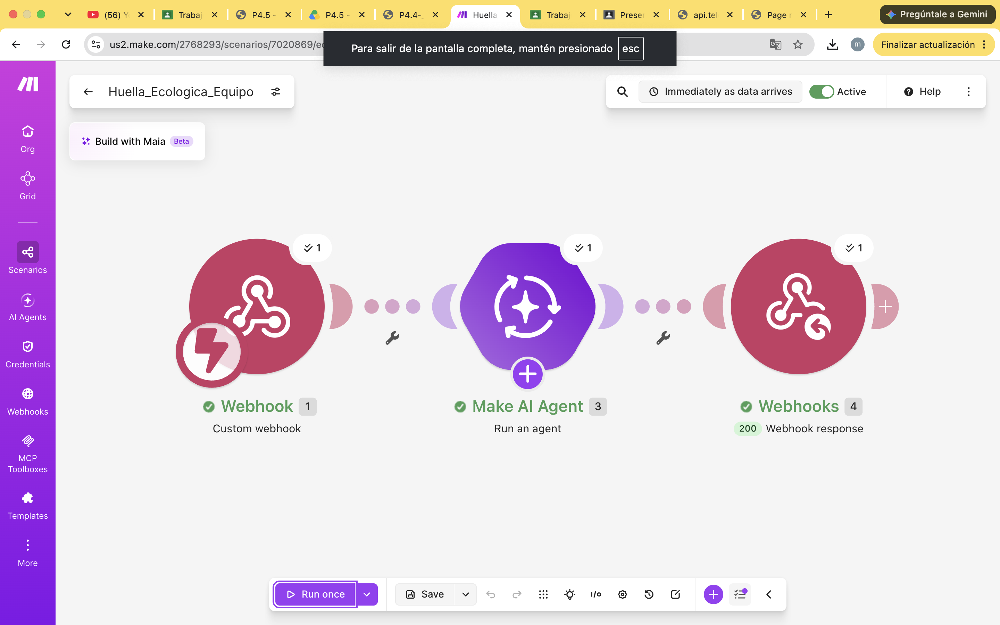

# Nombre del proyecto
automatización con make

## Objetivos de aprendizaje

Que el alumno calcule y compare su huella ecológica, identifique qué hábitos la elevan y proponga
estrategias económicas y personales para reducirla, evaluando la precisión de una estimación
hecha con IA.

## Material utilizado

- make.com
- telefono celular
- laptop

## codigo
[main.txt](codigo/main.txt)

## Video del funcionamiento

[readme](video/readme.txt)

[Ver video en YouTube](https://youtu.be/8I4Kr8NNk9M
)

## imagenes

## Reporte
Incluye:
[Reporte_Practica_4_3_Huella_energetica_de_la_nube.pdf](resultados/Reporte_Practica_4_3_Huella_energetica_de_la_nube.pdf)

## Conclusiones
Aunque ver un video o preguntarle algo a una IA parece gratis, cada acción consume electricidad y agua en centros de datos. Ese costo lo absorben la sociedad y el ambiente, no quien usa el servicio, y por eso es una externalidad. Estimar nuestra propia huella, con sus límites, ayuda a tomar mejores decisiones de uso y a exigir que el costo se refleje en el precio.

