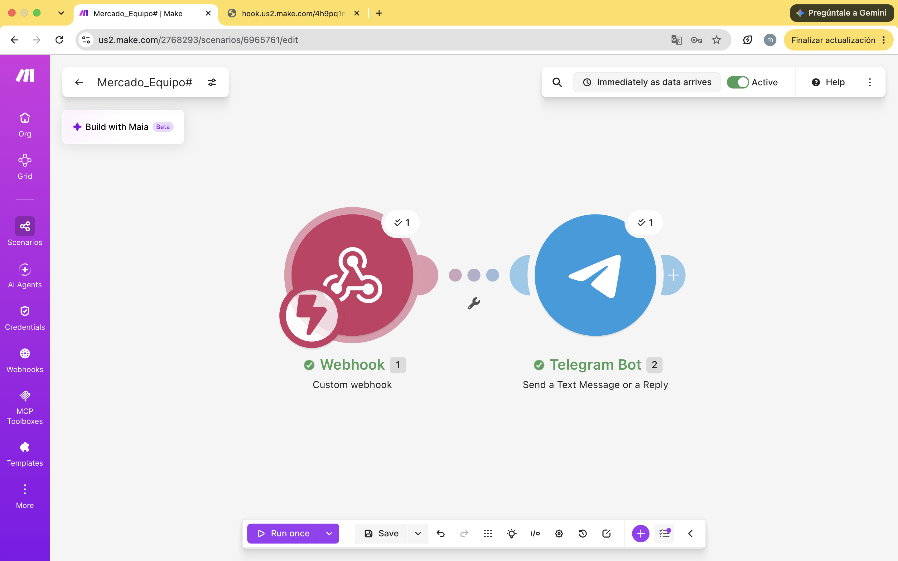

# Nombre del proyecto
automatización con chatbot de demanda

## Objetivos de aprendizaje
Entender la economía: el precio del camarón sube cuando hay poca oferta (por ejemplo, en una veda) y baja cuando hay sobreproducción.
Relacionarlo con el ambiente: ver cómo la escasez de un recurso natural afecta su precio.
Automatizarlo: hacer un simulador con potenciómetros y Arduino que calcule el precio y mande una alerta a Telegram cuando haya escasez.
## Material utilizado

- make.com
- telefono celular
- proto
- arduino
- cables
- potenciometro
- laptop
- modulo de IA
 

## codigo
[main.txt](codigo/main.txt)

## Video del funcionamiento

[readme](video/readme.txt)

[Ver video en YouTube](https://youtube.com/shorts/1IBD8KCilRA)

## imagenes

## Reporte
Incluye:
[reporte4.1.pdf](resultados/reporte4.1.pdf)

## Conclusiones
La práctica mostró que cuando un recurso natural escasea, como el camarón durante una veda, su precio sube, y que cuando hay sobreproducción baja. Además, automatizar una alerta con Arduino, Make y Telegram ayuda a un productor o cooperativa a enterarse a tiempo de los cambios del mercado. Medidas como la veda reducen la oferta a corto plazo, pero protegen la especie y la pesca a largo plazo.
