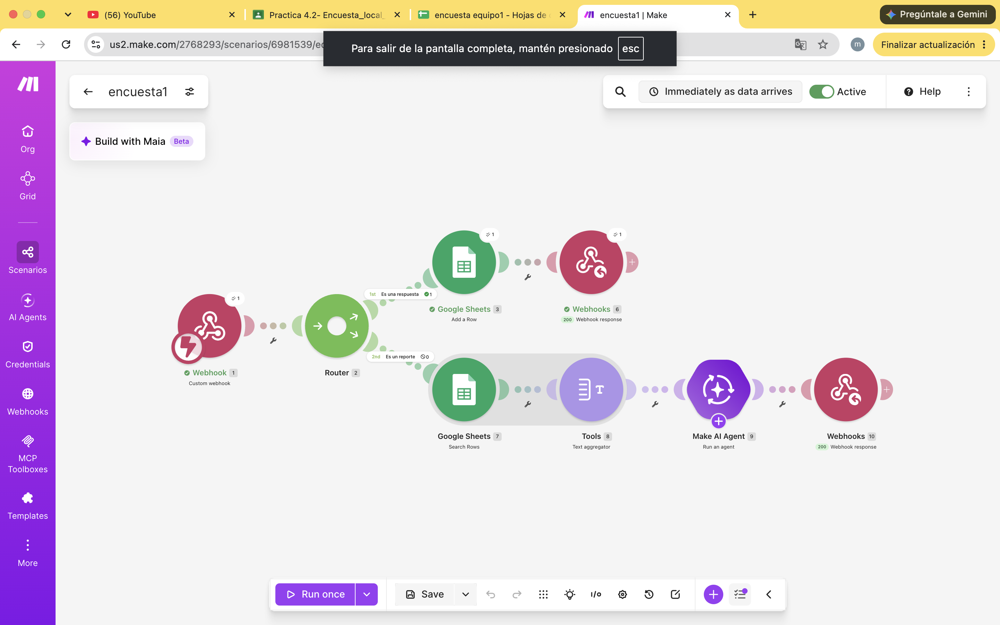

# Nombre del proyecto
automatización con make

## Objetivos de aprendizaje
Entender la economía: el precio del camarón sube cuando hay poca oferta (por ejemplo, en una veda) y baja cuando hay sobreproducción.
Relacionarlo con el ambiente: ver cómo la escasez de un recurso natural afecta su precio.
Automatizarlo: hacer un simulador con potenciómetros y Arduino que calcule el precio y mande una alerta a Telegram cuando haya escasez.
## Material utilizado

- make.com
- telefono celular

- laptop

## codigo
[main.txt](codigo/main.txt)

## Video del funcionamiento

[readme](video/readme.txt)

[Ver video en YouTube](https://youtu.be/kAEN0qyqKrce)

## imagenes

## Reporte
Incluye:
[reportepre.pdf](resultados/reportepre.pdf)

## Conclusiones
La práctica mostró
