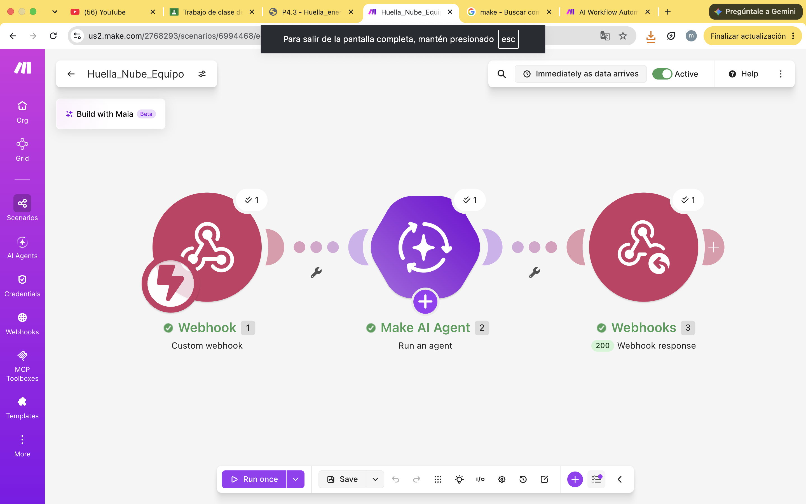

# Nombre del proyecto
automatización con make

## Objetivos de aprendizaje
Identificar los hábitos de compra local y global de mi comunidad, relacionarlos con la economía regional y el PIB, y construir un sistema de encuesta con análisis automático cuyos resultados se puedan verificar.

## Material utilizado

- make.com
- telefono celular
- laptop

## codigo
[main.txt](codigo/main.txt)

## Video del funcionamiento

[readme](video/readme.txt)

[Ver video en YouTube](https://youtu.be/JxikE1ZS_HQ)

## imagenes

## Reporte
Incluye:
[reporteencues.pdf](resultados/reporteencues.pdf)

## Conclusiones
La práctica permitió ver cómo las compras diarias de una comunidad se reparten entre lo local y lo global, y que ese reparto afecta la economía regional y el ambiente. También mostró que una IA puede resumir datos rápido pero puede equivocarse al contar, por lo que sus resultados deben verificarse con fórmulas en la hoja de cálculo

