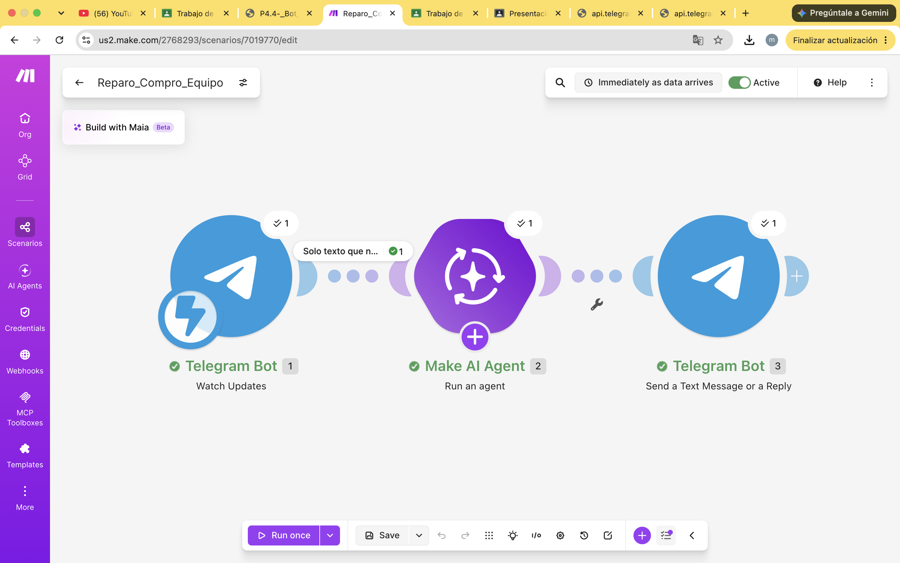

# Nombre del proyecto
automatización con make

## Objetivos de aprendizaje

Reconocer el consumo de energía de los servicios digitales como un costo externalizado y estimar la huella digital personal con apoyo de IA, evaluando de forma crítica sus suposiciones. Se construyó una página web (HTML, CSS y JavaScript) donde cada persona captura su uso semanal de video, música, redes sociales, videollamadas, juegos, almacenamiento en la nube, chatbots de IA y correos. La página envía los datos a un webhook de Make, un Make AI Agent estima energía y emisiones, y un Webhook Response devuelve el texto a la página. Se publica con GitHub Pages.

## Material utilizado

- make.com
- telefono celular
- laptop

## codigo
[main.txt](codigo/main.txt)

## Video del funcionamiento

[readme](video/readme.txt)

[Ver video en YouTube](https://youtu.be/H0SuTfDrflw)

## imagenes

## Reporte
Incluye:
[Reporte_Practica_4_3_Huella_energetica_de_la_nube.pdf](resultados/Reporte_Practica_4_3_Huella_energetica_de_la_nube.pdf)

## Conclusiones
Aunque ver un video o preguntarle algo a una IA parece gratis, cada acción consume electricidad y agua en centros de datos. Ese costo lo absorben la sociedad y el ambiente, no quien usa el servicio, y por eso es una externalidad. Estimar nuestra propia huella, con sus límites, ayuda a tomar mejores decisiones de uso y a exigir que el costo se refleje en el precio.

